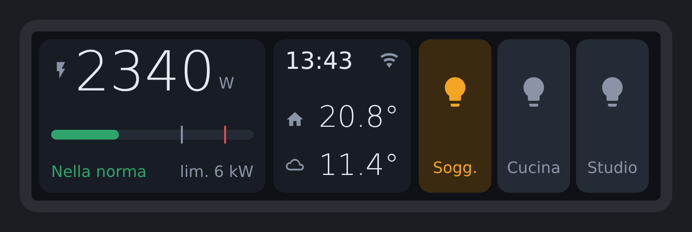

# ESPHome HA Strip — Waveshare ESP32-S3-Touch-LCD-3.49

Striscia touch 640×172 da scrivania per Home Assistant, basata su ESPHome + LVGL.
Niente custom integration, niente blueprint: tutta la logica sta nello YAML.

<p align="center"></p>

<sub>Anteprima indicativa del layout (mockup), non uno screenshot del dispositivo.</sub>

**Pagina Casa**
- Consumo istantaneo con barra e tacche sulle soglie (verde / arancio / rosso)
- Orario, stato connessione, temperatura interna ed esterna
- 3 tasti on/off (luci o qualsiasi entità `light.*` / `switch.*`) che seguono lo stato reale

**Pagina Stanze**
- 4 temperature in fila

Cambio pagina: swipe orizzontale, oppure tocco sulla card dell'orario
(e su una stanza per tornare indietro). Dopo un periodo di inattività la
luminosità si abbassa; il tocco la riporta piena.

## Hardware

| | |
|---|---|
| Scheda | Waveshare ESP32-S3-Touch-LCD-3.49 (versioni **-EN**, senza batteria) |
| Display | 3,49" IPS 172×640, AXS15231B via QSPI, usato in orizzontale |
| Touch | AXS15231B via I2C |
| MCU | ESP32-S3R8, 16 MB flash, 8 MB PSRAM |

Pinout e parametri del display presi da
[cryptooth/homeassistant-waveshare-lcd349](https://github.com/cryptooth/homeassistant-waveshare-lcd349) (MIT).
Il latch di alimentazione per la batteria non è gestito: con le versioni a
batteria il pannello si spegne quando stacchi l'USB.

Tutto l'hardware è isolato in `packages/hardware/`: per un'altra scheda basta
un file che esponga `tft_display`, `tft_touch` e `display_backlight`.

## Struttura

```
packages/
  hardware/waveshare-s3-touch-lcd-349.yaml  display, touch, retroilluminazione
  base.yaml                                 wifi, api, ota, orario, rotazione
  ha_data.yaml                              entità HA (segnaposto via substitutions)
  ui.yaml                                   interfaccia LVGL 640x172
ha-strip.example.yaml                       esempio di deploy
secrets.example.yaml
```

## Installazione

1. Copia `ha-strip.example.yaml` nella tua cartella ESPHome.
2. Imposta le substitutions con le tue entità (vedi tabella sotto).
3. Aggiungi le chiavi di `secrets.example.yaml` al tuo `secrets.yaml`.
4. Primo flash via USB, poi OTA.
5. In Home Assistant: **Impostazioni → Dispositivi e servizi → ESPHome → Configura**
   sul dispositivo e abilita **"Consenti al dispositivo di eseguire azioni Home Assistant"**,
   altrimenti le luci non rispondono al tocco.

## Substitutions

| Chiave | Default | Note |
|---|---|---|
| `ent_power_total` | `sensor.power_total` | W |
| `power_warn` / `power_limit` | `4500` / `6000` | soglie colore e tacche, in W |
| `power_limit_label` | `6 kW` | testo sotto la barra |
| `power_max_scale` | `7000` | fondo scala della barra |
| `ent_temp_in` / `ent_temp_out` | — | sensori °C |
| `ent_light_N` / `label_light_N` | — | N = 1..3, etichette corte (~7 caratteri) |
| `ent_room_N` / `label_room_N` | — | N = 1..4 |
| `display_rotation` | `90` | `270` per capovolgere |
| `touch_swap_xy` / `touch_mirror_x` / `touch_mirror_y` | `true` / `false` / `true` | calibrazione touch |
| `idle_timeout` | `60s` | |
| `brightness_active` / `brightness_idle` | `100%` / `15%` | |

**Temperatura esterna da un'entità `weather`**: crea un template sensor in HA
(`{{ state_attr('weather.casa', 'temperature') }}`) e usalo come `ent_temp_out`.

## Limiti noti / TODO

- Non ancora provato sull'hardware: rotazione e calibrazione del touch potrebbero richiedere aggiustamenti.
- Il tocco che riaccende lo schermo attiva anche il widget sotto il dito.
- Microfoni, speaker, IMU e RTC non sono usati (possibile evoluzione: satellite vocale Assist).

## Licenza

MIT
